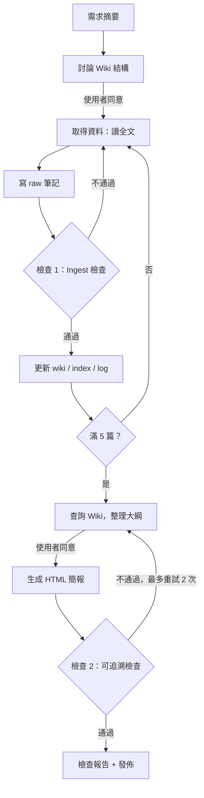

# RAG LLM Wiki 與教學簡報

**繳交標題**：〔學校〕 〔學號〕 〔系級〕 〔姓名〕 RAG

主題：RAG（Retrieval-Augmented Generation，檢索增強生成）｜用 LLM Wiki 製作教學 HTML 簡報

## 1. LLM Wiki 主題與簡短介紹
主題是 RAG（Retrieval-Augmented Generation）。。Wiki 涵蓋：RAG 概念、檢索與向量、chunking、Contextual Retrieval、RAG 與微調、常見失敗點。

## 2. LLM Wiki 成果
- 原始資料筆記（5 篇）：[`raw/`](raw/)
- 整理後的 Wiki：[`wiki/index.md`](wiki/index.md)，操作紀錄見 [`wiki/log.md`](wiki/log.md)
- 「先討論、後生成」：規則寫在 [`AGENTS.md`](AGENTS.md)，每篇 ingest 前先討論要寫入的頁面，紀錄在 log.md
- 需求摘要：[`requirements.md`](requirements.md)

## 3. 教學 HTML 簡報
- 線上瀏覽：`https://〔帳號〕.github.io/〔repo 名稱〕/`（根目錄 `index.html` 會自動導向簡報；也可直接開 `slides/`）
- 檔案：[`slides/index.html`](slides/index.html)，每頁底部標註對應的 Wiki 頁面
- 教學結構（17 頁）：為什麼需要 → 閉書 vs 開書 → 論文架構 → 流程 → 檢索 → 切塊 → Contextual Retrieval 與 reranking → 論文實驗 → 與微調比較 → 七個失敗點 → 工程經驗 → 小結與自我測驗 → 參考資料

## 4. loop / graph 設計
流程圖原始碼：[`workflow.mmd`](workflow.mmd)（可貼到 GitHub 的 mermaid 區塊顯示）

- **重複執行**：「取得資料→寫 raw→檢查 1→更新 wiki」每篇資料跑一次，共 5 次；檢查 2 不通過時回到大綱重做，最多 2 次
- **檢查或重新生成**：檢查 1 擋下無出處的數字與「只讀摘要」的資料；檢查 2 逐頁比對簡報與 wiki
- **為什麼這樣設計**：AI 最容易在「憑印象補數字、補名稱」時出錯。把檢查放在資料進 Wiki 的當下，比等簡報完成才檢查便宜，因為錯誤只影響一個頁面，還沒擴散到簡報

## 5. 一次實際執行的結果
見 [`check-report.md`](check-report.md)。重點：5 篇皆讀全文；兩輪檢查共攔下 3 個錯誤（Pinecone 數字、失敗點名稱、簡報數字無出處）。

## 6. 反思
- **最常出錯的節點**：「取得資料」。第一版只讀摘要與第三方整理，結果 Pinecone 的建議數字不在原頁，七個失敗點的名稱也與原文不同
- **檢查前移到哪裡**：原本只打算在簡報完成後檢查；後來把檢查提前到 ingest，規則是「必須讀全文，只讀摘要要標明，沒出處的句子標【待核對】」。簡報完成後再加一道腳本檢查，比對簡報數字是否都在 wiki
- **是否修改 workflow**：有。(1) 新增「檢查 1」並讓它可退回「取得資料」；(2) 「取得資料」改為必須讀全文；(3) 檢查 2 加入數字對照腳本，因為它抓到了簡報中有 3 個數字（1926、626M、2016）在 wiki 沒有出處
- **一個意外發現**：Barnett 論文自己的 §1 與 §4.3 文件數不一致。這說明「來源本身也可能有問題」，檢查節點不能只檢查 AI，也要檢查來源

## 說明
- `raw/` 與 `wiki/` 為依 5 篇來源整理的學習筆記，僅引用簡短片段，內容版權屬原作者；請以各來源原文為準
- 簡報中的數字皆可在 `wiki/` 找到出處，並回溯到 `raw/` 的章節
- 資料取得日期：2026-11-10
